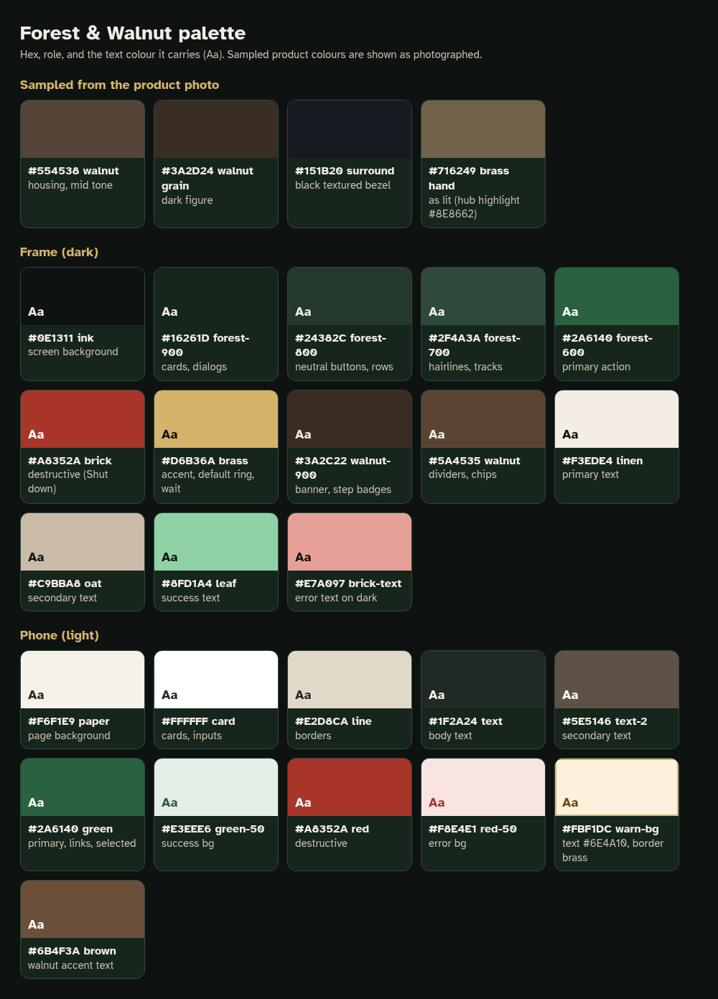
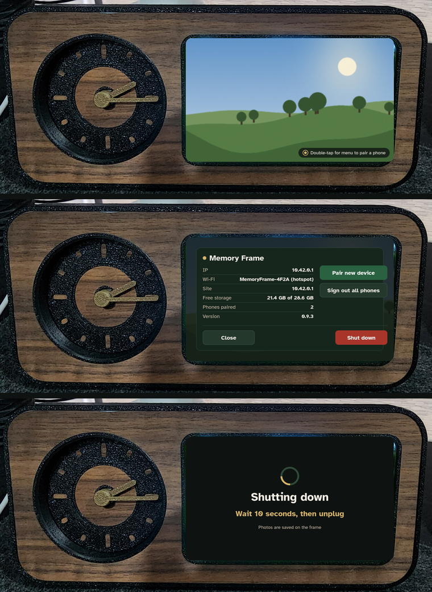

# Memory Frame visual direction: Forest & Walnut

*Wren (Designer), 17 Oct 2026. Mocks only, for the user's sign-off. No app code changes; not to merge as-is.*

The brief: *"a modern UI for both the physical product screen and the site the phone connects to. The design must
blend functional clarity, fast performance, and human centric layouts rather than relying on pure decoration.
Forest green and browns would be my preference to match the product."*

The direction in one line: **the frame screen is a dark forest-green surface that melts into the black surround, with
brass as the one accent (echoing the clock's gold hand); the phone site is warm paper with the same forest green
for actions and a forest header band, so the two feel like one product.** Every decision below favours legibility at
arm's length, big targets and cheap rendering on the Pi over ornament.

*In context: three frame mocks composited into the product photo's screen (slideshow, menu, frozen shutdown frame).*

## 1. Palette

### Sampled from the product photo (as photographed)

| Sample | Hex | Notes |
|---|---|---|
| Walnut, mid tone | `#554538` | median of the housing; light figure `#6E5C46`, dark grain `#3A2D24` |
| Black textured surround | `#151B20` | bezel and clock ring, slightly cool |
| Brass hand | `#716249` | as lit in the photo (hub highlight `#8E8662`); the real metal reads brighter, hence the screen's brass `#D6B36A` |

### Frame (dark)

| Token | Hex | Role |
|---|---|---|
| `--mf-ink` | `#0E1311` | Screen background behind overlays and full-screen states. Near the surround `#151B20` (1.08:1), so the screen's edge disappears into the bezel instead of glowing as a grey rectangle. |
| `--mf-forest-900` | `#16261D` | Overlay cards and dialogs |
| `--mf-forest-800` | `#24382C` | Neutral/secondary buttons (Close, Cancel), list rows |
| `--mf-forest-700` | `#2F4A3A` | 1 px borders, progress tracks, spinner track |
| `--mf-forest-600` | `#2A6140` | Primary action fill (Pair new device) |
| `--mf-brick` | `#A8352A` | Destructive fill (Shut down). A brick/oxblood red that sits with walnut rather than a signal red. |
| `--mf-brass` | `#D6B36A` | The one accent: default-button ring, step badges, countdowns, brightness fill, "Wait 10 seconds" |
| `--mf-walnut-900` | `#3A2C22` | Brown surface: dev-mode banner, step badge fill |
| `--mf-walnut` | `#5A4535` | Dividers, chips (decorative; never behind small text) |
| `--mf-linen` | `#F3EDE4` | Primary text (warm off-white, softer than pure white at night) |
| `--mf-oat` | `#C9BBA8` | Secondary text |
| `--mf-leaf` | `#8FD1A4` | Success text and ticks |
| `--mf-brick-text` | `#E7A097` | Error text on dark surfaces |
| `--mf-scrim` | `rgba(14,19,17,.82)` | Flat scrim behind dialogs (no blur) |
| `--mf-pill` | `rgba(14,19,17,.78)` | Small hint/toast pills over the photo |
| QR | `#FFFFFF` / `#000000` | QR codes stay pure black on pure white with a 4-module white quiet zone, never tinted |

### Phone (light)

| Token | Hex | Role |
|---|---|---|
| `--mf-paper` | `#F6F1E9` | Page background (warm, readable outdoors) |
| `--mf-card` | `#FFFFFF` | Cards and inputs |
| `--mf-line` | `#E2D8CA` | Borders, dividers |
| `--mf-text` | `#1F2A24` | Body text |
| `--mf-text-2` | `#5E5146` | Secondary text (walnut-grey) |
| `--mf-green` | `#2A6140` | Primary buttons, links, selected segments, focus ring |
| `--mf-green-50` | `#E3EEE6` | Success / summary background |
| `--mf-red` | `#A8352A` | Destructive (Sign out all phones), errors |
| `--mf-red-50` | `#F8E4E1` | Error background |
| `--mf-warn-bg` / `--mf-warn-text` | `#FBF1DC` / `#6E4A10` | Warning box (with a brass `#D6B36A` border and "!" badge) |
| `--mf-brown` | `#6B4F3A` | Walnut accent text and icons |
| header band | `#16261D` + `#F3EDE4` | Same forest as the frame cards; brass dot as the brand mark |

### How it sits on the product

- **Black surround:** all frame surfaces are 1.08 to 1.4:1 against the bezel, so overlays read as "the frame is
  talking" rather than "a computer screen is on". Only content glows.
- **Walnut:** the browns are used sparingly on screen (banner, badges, dividers). Big brown areas next to real
  walnut look like a bad imitation of wood, so the screen leans green and lets the housing carry the brown.
- **Gold hand:** brass is the only warm, saturated colour on the frame UI, used for "pay attention" moments (default
  button, countdowns, the shutdown instruction), echoing the clock hand a few centimetres to the left.
  It's brighter than the photographed hand (`#716249`) because the screen emits light and the hand reflects it.
- **Red:** brick `#A8352A` is reserved for one thing on the frame, Shut down, so it never competes with brass.

### WCAG contrast (computed with `tools/contrast.py`)

Key frame text (titles, body, the code, the shutdown instruction) is AAA. Everything else is at least AA.

| Surface | Text | Background | Ratio | Level |
|---|---|---|---|---|
| Frame | Linen #F3EDE4 (titles, body) | Ink #0E1311 | 16.11:1 | AAA |
| Frame | Linen #F3EDE4 | Forest-900 #16261D (cards) | 13.58:1 | AAA |
| Frame | Linen #F3EDE4 | Forest-800 #24382C (neutral button) | 10.76:1 | AAA |
| Frame | Oat #C9BBA8 (secondary) | Ink #0E1311 | 9.96:1 | AAA |
| Frame | Oat #C9BBA8 | Forest-900 #16261D | 8.39:1 | AAA |
| Frame | Oat #C9BBA8 | Forest-800 #24382C | 6.65:1 | AA |
| Frame | Brass #D6B36A ('Wait 10 seconds…', countdown) | Ink #0E1311 | 9.39:1 | AAA |
| Frame | Brass #D6B36A | Forest-900 #16261D | 7.91:1 | AAA |
| Frame | Brass #D6B36A (step numbers) | Walnut-900 #3A2C22 | 6.73:1 | AA |
| Frame | White #FFFFFF | Forest-600 #2A6140 (primary) | 7.29:1 | AAA |
| Frame | White #FFFFFF | Brick #A8352A (Shut down) | 6.55:1 | AA |
| Frame | Ink #0E1311 | Brass #D6B36A (Switch) | 9.39:1 | AAA |
| Frame | Linen #F3EDE4 (dev banner) | Walnut-900 #3A2C22 | 11.54:1 | AAA |
| Frame | Leaf #8FD1A4 (success) | Forest-900 #16261D | 8.90:1 | AAA |
| Frame | Brick-text #E7A097 (errors) | Forest-900 #16261D | 7.43:1 | AAA |
| Phone | Text #1F2A24 | Paper #F6F1E9 | 13.20:1 | AAA |
| Phone | Text #1F2A24 | Card #FFFFFF | 14.84:1 | AAA |
| Phone | Text-2 #5E5146 | Paper #F6F1E9 | 6.81:1 | AA |
| Phone | Text-2 #5E5146 | Card #FFFFFF | 7.66:1 | AAA |
| Phone | White #FFFFFF | Green #2A6140 (primary, selected) | 7.29:1 | AAA |
| Phone | Green #2A6140 (links, Saved) | Paper #F6F1E9 | 6.48:1 | AA |
| Phone | Green #2A6140 | Green-50 #E3EEE6 | 6.12:1 | AA |
| Phone | White #FFFFFF | Red #A8352A | 6.55:1 | AA |
| Phone | Red #A8352A (Sign out link) | Card #FFFFFF | 6.55:1 | AA |
| Phone | Red #A8352A | Red-50 #F8E4E1 | 5.35:1 | AA |
| Phone | Warn-text #6E4A10 | Warn-bg #FBF1DC | 7.06:1 | AAA |
| Phone | Linen #F3EDE4 (header) | Forest-900 #16261D | 13.58:1 | AAA |
| Phone | Oat #C9BBA8 (status strip) | Walnut-900 #3A2C22 | 7.14:1 | AAA |

Non-text (WCAG 1.4.11, 3:1):
- brass default ring on ink: 9.39:1
- brass ring on card: 7.91:1
- forest-700 card border on ink: 1.93:1
- green focus ring on paper: 6.48:1
- brass warning border on warn-bg: 1.78:1
- line on paper: 1.25:1

Card borders, the warning-box border and phone dividers are decorative: meaning is carried by fill, text and the
"!" badge, so they aren't required to reach 3:1. The default/focus rings, which do carry meaning, are 6.5:1 or more.

## 2. Type

- **Frame:** one small local font, **Atkinson Hyperlegible** (SIL OFL), Regular and Bold only, about 2 x 30 KB woff2
  once subset to Latin. It was designed for low-vision legibility: distinct 0/O, 1/l/I and slashed zero, which helps for
  IP addresses and the pairing code. Fallback: `"DejaVu Sans", "Liberation Sans", sans-serif` (preinstalled on
  Raspberry Pi OS). Served from `/static/fonts/`, so it works offline. (Not added in this PR; the mocks use the copy installed on the box.)
- **Phone:** system stack `system-ui, -apple-system, "Segoe UI", Roboto, "Noto Sans", sans-serif` (no font download;
  Roboto on Android). Mocks are rendered with Roboto.

| Frame role (800x480, about 190 dpi, arm's length) | Size / weight |
|---|---|
| Full-screen headline ("Shutting down") | 44 px bold |
| Pairing code | 56 to 64 px bold, tabular digits |
| Dialog / overlay title | 30 px bold (28 on the dense error screen) |
| Body, button labels | 22 px (buttons bold) |
| Labels, QR captions, table | 20 px |
| Hints, banner, minimum | 18 px. Nothing smaller on the frame. |

| Phone role (412 px wide) | Size |
|---|---|
| H1 | 28 px bold |
| H2 / card title | 20 px bold |
| Body | 17 px |
| Small, minimum | 15 px |

## 3. Space, shape, touch

- Spacing scale: **4, 8, 12, 16, 24, 32, 48 px** (`--mf-s-1` to `--mf-s-7`). Frame screens use 24 to 28 px outer
  margins; the phone uses 16 px.
- Radius: 8 px (inputs, chips, QR tile), 12 px (buttons), 16 px (cards, dialogs), pill for hints and toasts.
  The 16 px card radius echoes the screen opening's rounded corners.
- Touch targets: **frame buttons are at least 56 px tall** (the 48 px minimum plus margin for imprecise taps on a
  standing frame), and at least 8 px apart; destructive and safe buttons are never adjacent without a gap.
  Phone: 48 px minimum, 56 px for primary actions.

## 4. Components

| Component | Frame | Phone |
|---|---|---|
| Primary button | forest-600 fill, white bold label | green fill, white label |
| Secondary / neutral | forest-800 fill + 2 px forest-700 border, linen label (Close, Cancel) | white fill, 1.5 px line border |
| Destructive | brick fill, white label, always on the **right** | red fill, or red text for a list-row action |
| Accent (non-destructive "are you sure") | brass fill, ink label (Switch to dev mode) | not used |
| Default button | 3 px brass outline, 3 px offset (Cancel in every confirm) | 3 px green outline |
| Overlay card | forest-900, 1 px forest-700 border, 16 px radius, 24 px padding, over a flat 82 % ink scrim | white card, 1 px line border |
| Confirm dialog | 600 px wide card: title, one-sentence body, two equal buttons; Cancel left and default, action right | bottom sheet with the same structure |
| Toast | forest-900 pill-card at top centre with a forest-600 tick disc; auto-hides; no shadow | green-50 summary box |
| Hint / banner | 78 % ink pill (hint, bottom right); walnut-900 tag with brass dot (dev banner, top left) | forest header + status strip (walnut-900, green dot) |
| List rows | 1 px forest-700 separators, label left (oat) and value right (linen bold) | 56 px rows, icon tile, chevron |
| QR card | pure white tile, 4-module quiet zone inside the image, black modules, never tinted or overlaid | (not used) |
| Spinner | 72 px ring: forest-700 track + one brass quarter-arc, rotating with `transform` | progress bar scaled with `transform: scaleX` |

## 5. Frame performance rules (Pi, Chromium kiosk)

1. **No `filter: blur`, no `backdrop-filter`.** Scrims and pills are flat semi-transparent fills.
2. **No box-shadows.** Edges are 1 px borders; the default ring is an `outline`.
3. **No gradients over the slideshow**, and none in the UI at all. (The placeholder photo has gradients because it's a photo.)
4. **CSS only**, no canvas/WebGL/SVG animation, no icon fonts (glyphs ☀ ✓ ! are text; badges are CSS circles).
5. **Light DOM**: each overlay is one container with a handful of children; hidden overlays use `hidden` (display:none), not opacity 0.
6. **Animate only `transform` and `opacity`**: overlay in/out is opacity 150 to 250 ms; buttons press with `scale(.97)`;
   the spinner rotates; brightness and countdown bars use `transform: scaleX()` rather than width.
7. **Text never animates.** Anything the panel might freeze on (shutdown) must be fully legible in any frame.
8. Tokens live in [`tokens.css`](tokens.css) as CSS custom properties.

## 6. Mocks

All rendered with headless Chromium (Playwright) from the HTML next to each PNG, using only CSS that follows the rules above.
Rebuild with `tools/make_assets.py`, `tools/make_frame_html.py`, `tools/make_phone_html.py`, `tools/render.py` and `tools/contact_sheet.py`.
The slideshow photo and thumbnails are procedurally generated placeholders (`assets/`), not real photos.

### Frame (800x480) — [contact sheet](frame/_contact-sheet.png)

| File | Screen | Notes |
|---|---|---|
| `01-slideshow-hint` | Slideshow with menu hint | "Double-tap for menu to pair a phone" pill, bottom right |
| `02-brightness` | Brightness overlay | sun glyph, brass bar (scaleX), tabular % |
| `03-pairing-wifi-site` | Pairing: 1 Join Wi-Fi QR, 2 Open site QR (http://10.42.0.1/), 3 code | as today's wifiStep + site + code |
| `04-pairing-site-only` | Pairing when the phone is already on the frame's Wi-Fi | site QR + code only |
| `05-paired-toast` | "Phone paired / Send photos from your phone." | |
| `06-hotspot-error` | "Memory Frame Wi-Fi didn't start" + 5 SD-card steps | current MF-36 wording, unchanged |
| `07-menu` | Double-tap menu **(#66)** | Close bottom-left (neutral), Shut down bottom-right (brick) |
| `08-shutdown-confirm` | "Shut down the frame?" **(#66)** | Cancel is the default (brass ring) |
| `09-dev-mode-confirm` | "Switch to dev mode?" **(#67)** | Cancel default; Switch in brass, not red (it isn't destructive) |
| `10-shutting-down` | **#65 option B**: spinner, "Shutting down", "Wait 10 seconds, then unplug" | instruction shown from the first frame |
| `11-shutting-down-frozen` | **#65 B frozen last frame** after power-off | spinner stopped mid-turn; still reads correctly |
| `12-dev-banner` | Dev-mode banner | "Developer Wi-Fi · <IP> · restart to exit" (today's string) |
| `13-wifi-rejoin` | MF-18 "Wi-Fi changed: scan to rejoin" with countdown | extra, so MF-18 matches the style |

**#65 note.** Option B puts the instruction on screen from the start instead of swapping text later, so wherever
the panel freezes, the user sees "Wait 10 seconds, then unplug" in AAA brass on ink. The spinner is a track plus an
arc, so a frozen arc still looks like "was busy", not like an error.

### Phone (412x915, Galaxy S22 Ultra CSS viewport) — [contact sheet](phone/_contact-sheet.png)

| File | Screen |
|---|---|
| `01-pair-code` | Pair this phone: 6-digit code boxes, Pair, "Can't see a code?" help |
| `02-home-library` | Home: status strip, Upload photos, library grid (with a Hidden photo), Frame Wi-Fi / Settings / Sign out all phones |
| `03-upload-progress` | Upload: free space, per-file status (Added, Already on the frame, Uploading 64 %, Waiting...), summary |
| `04-settings` | Slide time 5 s / 10 s / 30 s / 1 min / 5 min, Fade / None, Shuffle switch, "Saved" |
| `05-wifi-change` | Frame Wi-Fi form with the "All phones will disconnect" warning |
| `06-wifi-confirm` | "Change Wi-Fi?" confirm sheet (Cancel default) |
| `07-keep-new-wifi` | "Keep new Wi-Fi?" with the countdown |
| `08-offline-error` | "Can't reach the frame": rejoin steps, Try again, an upload error |

## 7. Open points for sign-off

1. Phone in a **light** theme (paper) vs a dark theme matching the frame. Light is recommended for daylight use and
   faster scanning; the forest header keeps the family resemblance.
2. **Atkinson Hyperlegible** as the one local frame font (about 60 KB), or system fonts only (DejaVu Sans on the Pi).
3. Phone home merges today's admin home and library into one page (Upload button + grid preview + rows). Today they're separate pages.
4. Wording that is new in these mocks (not in the app yet): "Type this on your phone if it asks for a code",
   "Photos are saved on the frame" under the shutdown instruction, "Can't see a code?", the offline-page steps, and
   the "8 to 63 letters, numbers or symbols" hint on the Wi-Fi form (matches the server rule in `memoryframe/wifi.py`).
