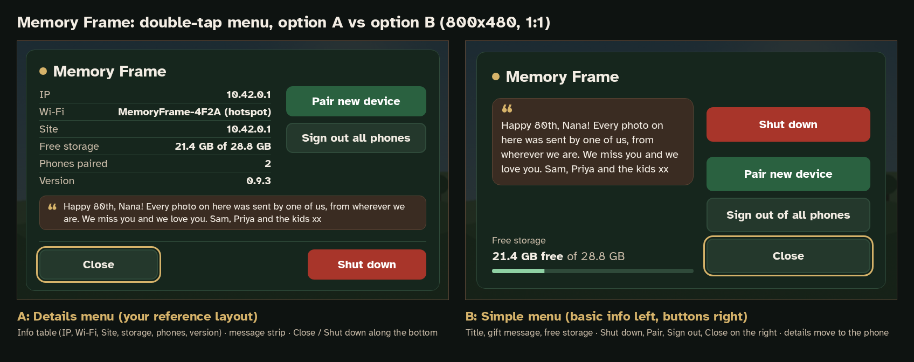

# Double-tap menu rework (menu v2): option A vs option B, dev-mode confirm fix, frame message

*Wren (Designer), 17 Oct 2026. Mocks only, for the user's sign-off (via Rowan → Sloane). No app code changes.
Same tokens and components as [DIRECTION.md](DIRECTION.md); rendered with `tools/render.py` (headless Chromium,
frame 800x480, phone 412x915). The #70 originals are kept unchanged.*

The user's brief: *"The menu brought up with double tap could use a rework (arrangement of buttons etc to make a bit more
user friendly). The join developer wifi buttons are up a bit higher than what they should be. I do like the looks of the
cancel button with the border around it, maybe bring that onto close on the menu and order the buttons vertically on the
right: Shut down, pair new device, sign out of all phones, then Close. Only basic info should be on the left e.g. title
Memory Frame, free storage and a custom message to the gift receiver."*

## Pick one: A or B

**Trade-off in one line:** A keeps the technical details (IP, Site, version), which are handy for setup and support but noise
for a gift receiver; B is simpler and friendlier, and those details move to the phone site's About page.

| | Option A: Details menu (`07-menu-optA*.png`) | Option B: Simple menu (`07-menu-optB*.png`) |
|---|---|---|
| Based on | The user's reference image (the #70 `07-menu` mock) | The user's written brief |
| Left | Info table: IP, Wi-Fi, Site, Free storage, Phones paired, Version; gift message as a 2-line strip under it | Title, gift message card (up to 140 chars), free storage with a slim bar |
| Buttons | Pair new device (green) and Sign out all phones on the right; Close bottom-left with the brass default ring; Shut down bottom-right (brick) | One stack on the right, top to bottom: Shut down (brick), Pair new device (green), Sign out of all phones, Close (brass default ring), all 64 px tall |
| Good for | Setup and support (you can read the address off the frame) | The person the frame was given to: fewer words, Close nearest the thumb |

## Frame mocks (800x480)

| File | What |
|---|---|
| `frame/07-menu-optA.png` | Option A with a message |
| `frame/07-menu-optA-empty.png` | Option A, no message: one dashed line with the hint |
| `frame/07-menu-optB.png` | Option B with a 138-character message (4 lines) |
| `frame/07-menu-optB-empty.png` | Option B, no message: dashed hint card |
| `frame/07-menu-AvsB.png` | Side-by-side board with captions (not a screen) |
| `frame/09-dev-mode-confirm-v2.png` | "Switch to dev mode?" with the card centred and the buttons pinned to the bottom |
| `frame/08-shutdown-confirm-v2.png` | The same fix applied to "Shut down the frame?" (it has the same bug, see below), so the two confirms match |

### Option B layout details
- Card inset 20 px from the screen edges, 28 px padding, two columns: info (flexible) and buttons (304 px), with a 24 px gap.
- The button stack is **bottom-aligned**, so Close is lowest (nearest the thumb on a standing frame) and **Shut down's top edge sits about
  124 px below the screen's top edge and 48 px in from the right edge**. There's a 28 px gap under Shut down (12 px between the others),
  so it's never right next to Pair. It still opens the "Shut down the frame?" confirm, with Cancel as the default.
- Close uses the neutral button with the **3 px brass default ring** (offset 3 px), the same as Cancel in the confirms. Close keeps focus when the menu opens.
- Gift message: walnut-900 card, 1 px walnut border, brass opening quote mark, linen 20 px regular text with 1.35 line height
  (no italic: the frame ships only Atkinson Regular and Bold). It's **capped at 5 lines** (`-webkit-line-clamp:5`, with an ellipsis):
  140 characters of normal mixed-case text is 4 lines; all caps or very long words can reach 5. `overflow-wrap:anywhere` stops long words from overflowing.
- Free storage sits at the foot of the left column, lined up with Close: "21.4 GB free" (bold) "of 28.8 GB" (oat), with an 8 px bar
  (leaf fill on a forest-700 track, scaled with `transform:scaleX(used)`). Suggestion: switch the fill to brass when less than 10 % is free.
- Order note: the brief lists title, storage, message. In B the **message sits right under the title and storage goes to the bottom**.
  The message is the human part, so it reads first; storage is a glance-only figure; and this avoids a dead gap in the middle of the column. Easy to swap if the user prefers.

### Option A layout details
- The reference layout, widened (card inset 16 px) so the right-hand buttons sit inside the card. In the #70 `07-menu` mock they ran about 15 px past the card's right edge.
- Table rows are 20 px with tighter row padding (3 px) to make room for the message strip: walnut-900, brass quote, 18 px linen, **capped at 2 lines** (140 normal characters fit in 2; all caps may be cut with an ellipsis).
- Close (bottom-left) now has the brass default ring; Shut down is bottom-right in brick. Buttons stay 56 px (the DIRECTION minimum), as in #70.

### Empty state (no message set): show a hint, not a blank
Copy: **"No message yet"** + **"Add one from your phone in Settings, under “Message on the frame”."** (A: one line, "No message yet. Add one from your phone in Settings, under “Message on the frame”.")
Oat text in a dashed 1 px walnut outline, with no fill and nothing that looks tappable.
Why the hint and not empty space: the person who opens the menu first is usually the giver setting the frame up. A hint is the only place on the
frame that tells them the feature exists and where to find it, whereas a blank space just looks like something failed to load. It's low-key
(secondary colour, no fill, no button look), so a receiver who sees it before a message is set isn't bothered, and it disappears as soon as a message is saved.
It deliberately has no link or QR, because the frame can't set the message itself.

## Where the removed info goes (option B)
IP / address, Wi-Fi name, Site, Phones paired and Version come **off the frame menu** and stay on the phone site:
- **Settings → About this frame** (new row at the bottom of Settings, in `04-settings-v2` and `04b`): Frame Wi-Fi, Address, Phones paired, Free storage, Version.
- Wi-Fi name and password changes are still on **Frame Wi-Fi** (home page row, `05-wifi-change`).
- The pairing screens (`03`/`04`) still show the Wi-Fi name and `http://10.42.0.1/`, so setup doesn't need the menu.
- The dev-mode banner (`12-dev-banner`) still shows the developer IP while dev mode is on, so support/dev access is unaffected.
- Free storage stays on the frame (in both options) and on the phone status strip.

## Phone mocks (412x915)

| File | What |
|---|---|
| `phone/04-settings-v2.png` | Settings with the new **Message on the frame** card first: multiline field (focused, editing), counter, helper, Save, live preview |
| `phone/04b-settings-message-saved.png` | Saved state: "✓ Saved" in the card title (same pattern as Slide time), the button turns into a disabled "Saved", a "Remove message" text button appears, and the preview label changes to "On the frame now" |

The preview is a small copy of the frame's note card (walnut, brass quote, the frame font if installed) at 75 % size and the same text width
ratio, so the line breaks and the 5-line cap match what the frame will show. With the system-font fallback, the line breaks can differ slightly.
Settings is slightly tightened (12 px card gaps, Transition on one row) so everything, including the About row, fits on one screen.

## Exact copy

| Where | Text |
|---|---|
| Frame menu title | Memory Frame |
| Storage label / value | Free storage · "21.4 GB free of 28.8 GB" (B) / "21.4 GB of 28.8 GB" (A table) |
| Buttons (B, top to bottom) | Shut down · Pair new device · Sign out of all phones · Close |
| Buttons (A) | Pair new device · Sign out all phones · Close · Shut down |
| Empty message (B) | No message yet / Add one from your phone in Settings, under “Message on the frame”. |
| Empty message (A) | No message yet. Add one from your phone in Settings, under “Message on the frame”. |
| Dev confirm | Switch to dev mode? / Phones on the frame's Wi-Fi will disconnect until you restart the frame. / Cancel · Switch (#67, approved) |
| Phone card title | Message on the frame |
| Helper / counter | Shown in the frame's menu · "138 / 140" |
| Editing | Save · Not saved yet · "Preview: how it will look on the frame" |
| Saved | ✓ Saved · Saved (disabled) · Remove message · "On the frame now" |
| About row | About this frame / Wi-Fi, address, phones paired, version |

Sign-out wording: B uses the user's "Sign out of all phones"; A keeps "Sign out all phones" from the reference. The confirm title stays "Sign out all phones?". Pick one when building.

## Dev-mode confirm: why the buttons sit too high (root cause)
Checked on `origin/main` @ 3dc2fae and PR #72 head `restyle-a-tokens` @ eea9d6e (the CSS rules are the same in both, only colours differ).
- `static/style.css:682` (main) / `:685` (PR #72): `#devModeBox{width:480px;min-height:260px;...;padding:20px 24px}` sets the card's minimum
  height but is a plain block, **not a flex column**.
- The buttons sit inside `#devModeAsk` (`templates/index.html:155-162` main / `:161-168` PR #72), a plain block that is only as tall as its content,
  and `.shutdownButtons` (`style.css:660` main / `:663` PR #72) is `display:flex` with **no `margin-top:auto`**. So the buttons follow right after the body
  text (`.confirmBody` margin `8px 0 16px`, `style.css:684` / `:687`), and the space left over from `min-height` collects **under** them.
- Measured at 800x480 with the real CSS: card y=110 to 370, buttons end at y=306. That's **64 px below the buttons vs 20 px above the title**
  (44 px of dead space), so the pair looks pushed up. The dialog itself is centred correctly (`.overlay{display:flex;align-items:center}`, `style.css:583`).
- The **same pattern is in the shut-down confirm**: `#shutdownBox` `style.css:657` / `:660`, and `.shutdownButtons` is shared, so the shut-down confirm measures identically.
  The sign-out confirm `#confirmBox` (`style.css:617-618` / `:620-621`) tries `flex-direction:column;justify-content:space-between` with a fixed
  `height:260px`, but its only child is `#confirmAsk`, so that rule does nothing and it has the same gap (about 80 px under the buttons).
- Suggested fix for Kit (B-PR, CSS only):
  `#devModeBox,#shutdownBox,#confirmBox{display:flex;flex-direction:column}`
  `#devModeAsk,#devModeDone,#shutdownAsk,#confirmAsk{flex:1;display:flex;flex-direction:column}`
  `.shutdownButtons,.confirmButtons{margin-top:auto;padding-top:24px}`. The existing `#…[hidden]{display:none}` rules keep their higher specificity.
  Mocks `08-`/`09-…-v2` use a 600 px card, min-height 272 px, 28 px padding on all sides, 64 px buttons pinned to the bottom, Cancel (default ring) left.
- Copy: the app still says "Join developer Wi-Fi?" / "Join" (`index.html:156,160` main). #67's approved "Switch to dev mode?" / "Switch" is used in the mock.

## Accessibility notes
- Contrast (from DIRECTION): linen on walnut-900 11.5:1 (message), oat on forest-900 8.4:1 (labels, empty hint), white on brick 6.6:1,
  white on forest-600 7.3:1, linen on forest-800 10.8:1, brass ring 7.9:1 on the card. Phone: text-2 on white 7.7:1, green on green-50 6.1:1 ("Saved").
- Targets: B buttons are 64 px tall and 304 px wide with 12 px (28 px under Shut down) gaps; A keeps 56 px. Both meet the 48 px minimum with margin.
- Nothing on the frame is smaller than 18 px; the message is 20 px (B) / 18 px (A).
- Focus: Close is the default and has initial focus in the menu; Cancel in every confirm. Shut down is never the default and always confirms.
- Semantics for the build: menu `role="dialog"` with `aria-label="Menu"`; message as a `<figure>` (the decorative quote mark is `aria-hidden`); the storage bar
  `role="img"` with an `aria-label` ("26% used"), or `<meter>`. On the phone: the textarea has a label, `maxlength="140"` and `aria-describedby` (helper + counter); the counter is `aria-live="polite"`;
  "✓ Saved" is `role="status"`.
- The message is user text: render it as text (no HTML), trim whitespace, collapse 3+ newlines, and limit to 140 characters on the server too.
- Performance: no blur, shadows or gradients. The clamp is CSS, the bar uses a transform, and the only press feedback is `transform:scale`.
